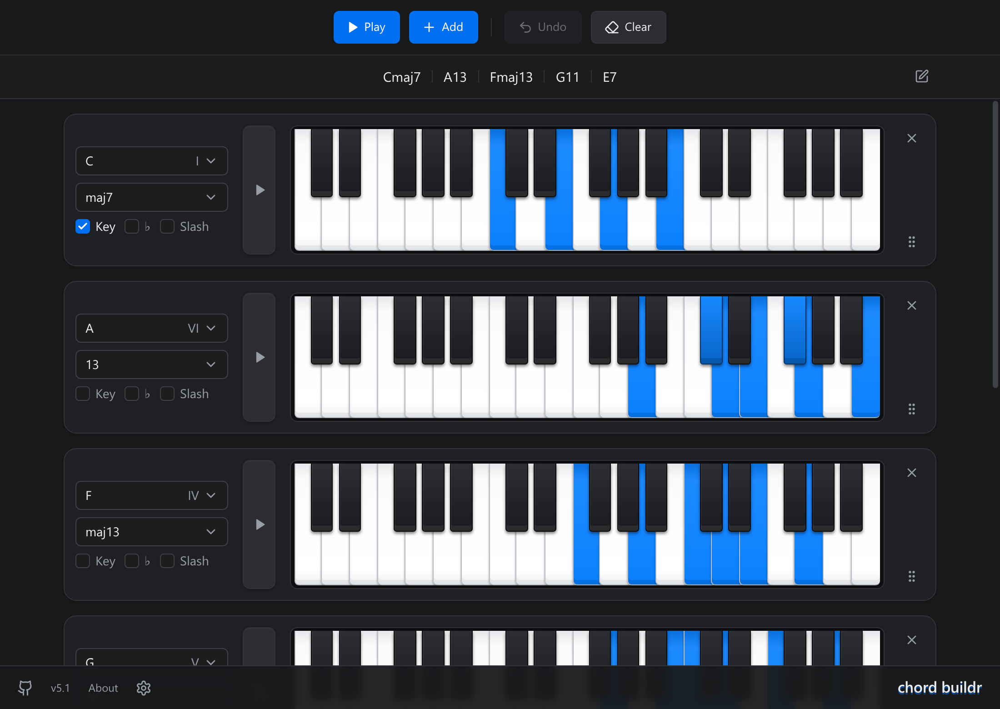
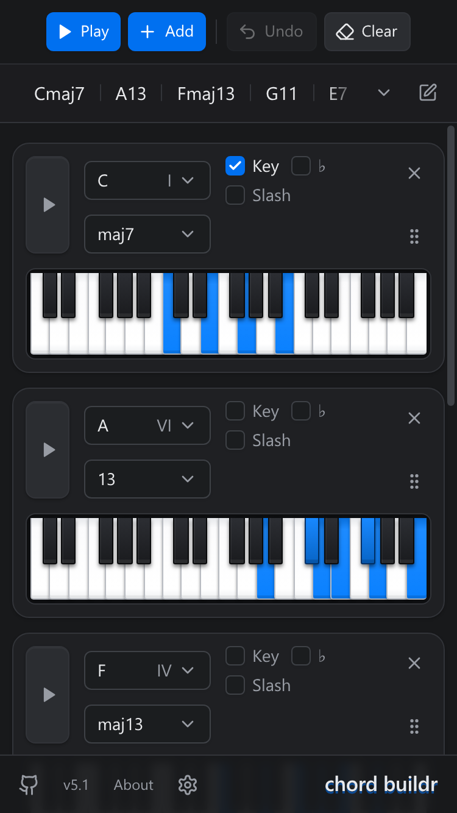
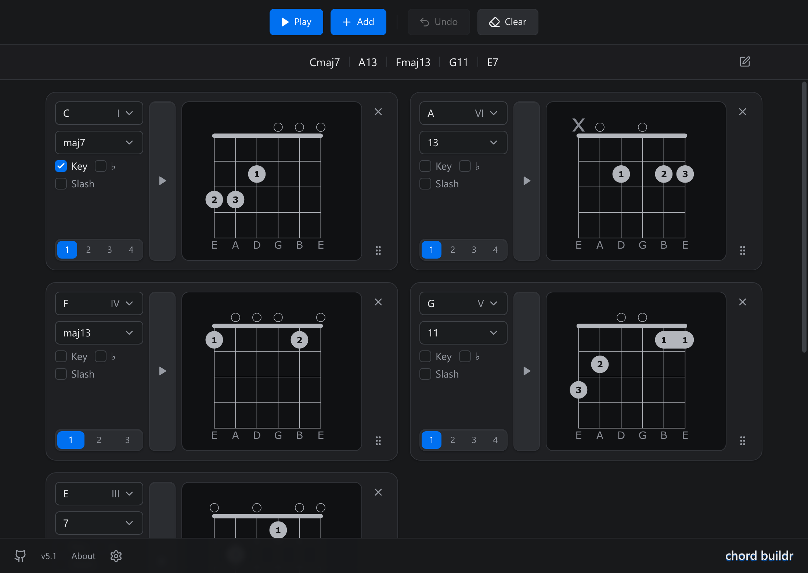
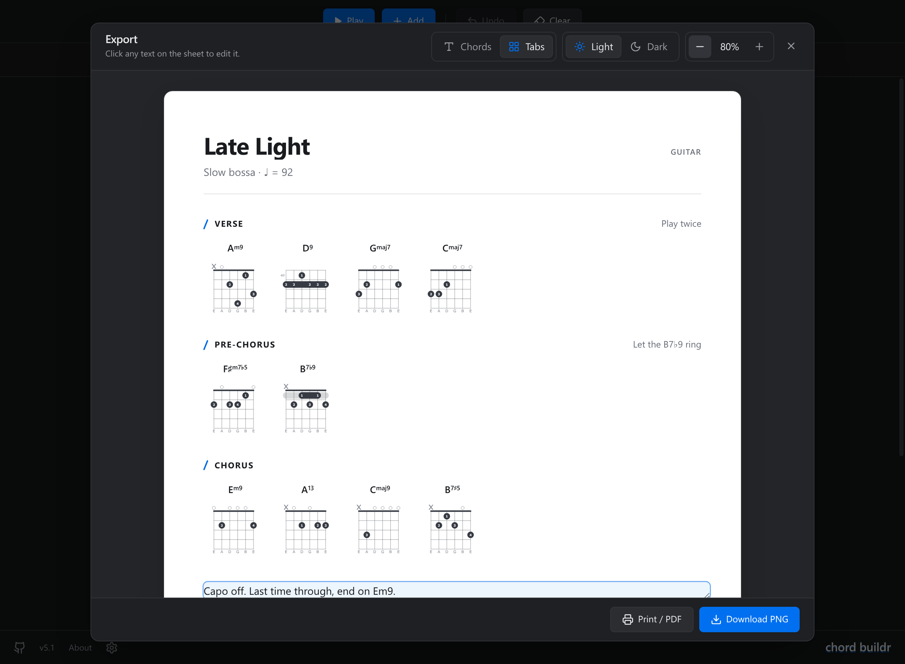

# Chord Buildr :musical_keyboard:

[chordbuildr.com](https://www.chordbuildr.com)

Chord Buildr was created to make it easy for musicians and music enthusiasts to explore and share chord progressions. Users can specify a series of chords, see their notes displayed on interactive keyboards or guitar/ukulele chord diagrams, transpose them, and play audio. Progressions are encoded in the URL, which can be saved for future reference or shared with others.

Chord Buildr is implemented in React and uses Tone.js for audio playback.

  
  &nbsp;&nbsp;&nbsp;
  

  
  

  
  

## Features

### Core Functionality
- **Chord Progression Creation**: Specify chords either through text input, dropdown selection, and/or click on notes.
- **Interactive Keyboard Display**: Visualize chord notes on interactive piano keyboards.
- **Audio Playback**: Listen to your chord progressions by clicking on the progression or chord play buttons.
- **Transposition**: Effortlessly transpose your progressions to different keys.
- **Shareable URLs**: Save and share your progressions through encoded URLs.
- **Guitar/Ukulele Chord Diagrams**: Display guitar chord diagrams with multiple positions to choose from. Chords can be displayed for either standard six-string or ukulele
 
### Music Theory Integration
- **Roman Numeral Notation**: View chord progressions in roman numeral notation when a key is selected.
- **Key-Aware Notation**: Note letters adjust to display the correct notation given the selected key.

### Customization Options
- **Synth Settings**: Adjust volume, EQ, and choose from multiple synth voice options.
- **Note Display**: Option to show notes as flats or sharps.

### User Interface
- **Mobile-Responsive Design**: Optimized interface for both desktop and mobile use.
- **Direct Progression Editing**: Edit your chord progression directly in text format.
- **Playback Controls**: Cycle through chords with a play button in the header.

## Tech Stack

- Typescript
- React
- Tailwind
- Shadcn
- Tone.js
- chords-db  
- Umami

## Getting Started

To run Chord Buildr locally:

1. Install dependencies with `bun install`
2. Start with `bun run start`
3. Execute tests with `bun run test`

## License

This project is open source and available under the [MIT License](LICENSE).
