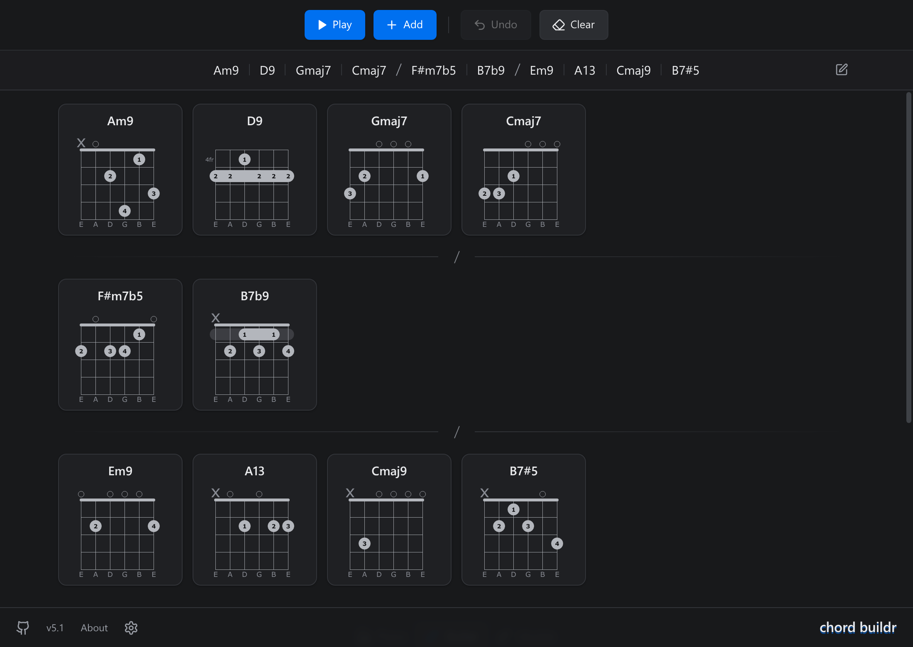
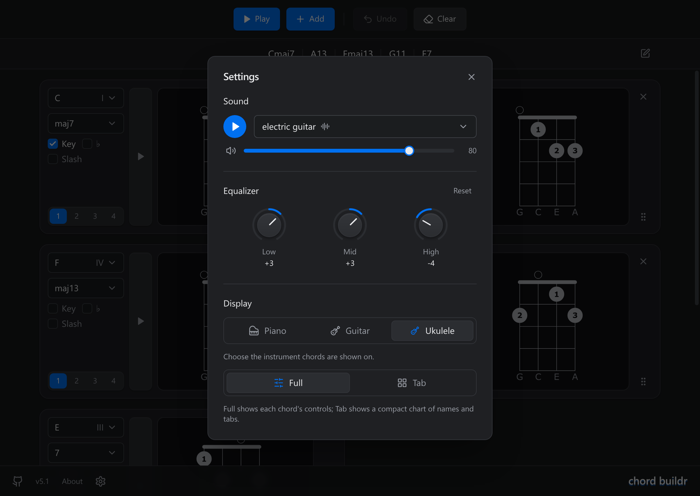

[](https://github.com/jekrch/chord-buildr/actions/workflows/test_on_push.yml)
[](https://opensource.org/licenses/MIT)

# Chord Buildr :musical_keyboard:

[chordbuildr.com](https://www.chordbuildr.com)

Chord Buildr makes it easy for musicians and music enthusiasts to explore and share chord progressions. Enter a series of chords, see their notes on interactive piano keyboards or guitar/ukulele chord diagrams, transpose them, and play them back. Progressions are encoded in the URL, so they can be bookmarked or shared with no account required.

<p float="left">
  
  &nbsp;&nbsp;&nbsp;
  
</p>
<p float="left">
  
  
</p>
<p float="left">
  
  
</p>

## Features

### Building Progressions
- **Chord Entry**: Add chords by typing them, picking from dropdowns, or clicking notes on the keyboard.
- **Text Editing**: Edit the whole progression as plain text.
- **Sections**: Split a progression into sections (verse, chorus, etc.) and drag chords to reorder them.
- **Transposition**: Transpose the whole progression to a different key.
- **Shareable URLs**: Every progression lives in the URL, ready to save or share.

### Instruments
- **Piano**: Chord notes highlighted on interactive keyboards.
- **Guitar & Ukulele**: Chord diagrams with multiple positions to choose from, or a compact tab view with slash chord support.

### Music Theory
- **Roman Numerals**: See each chord's roman numeral when a key is selected.
- **Key-Aware Notation**: Note names follow the selected key, and any chord can be switched between flats and sharps.

### Playback
- **Audio**: Play a single chord or the whole progression, or step through chords with the play button in the header.
- **Voices**: Choose from synth voices or sampled electric guitar, acoustic guitar, and harp.
- **Sound Settings**: Adjust volume and EQ.

### Export
- **Chord Sheets**: Export a progression as a PNG or print it, with editable titles, section labels, and notes.

Chord Buildr works on both desktop and mobile.

## Tech Stack

- TypeScript
- React
- Vite
- Tailwind
- shadcn/ui
- Tone.js
- Tonal
- chords-db
- Umami

## Getting Started

To run Chord Buildr locally with [Bun](https://bun.sh):

```sh
bun install
bun run start   # http://localhost:3000
bun run test
```

## License

This project is open source and available under the [MIT License](LICENSE).
